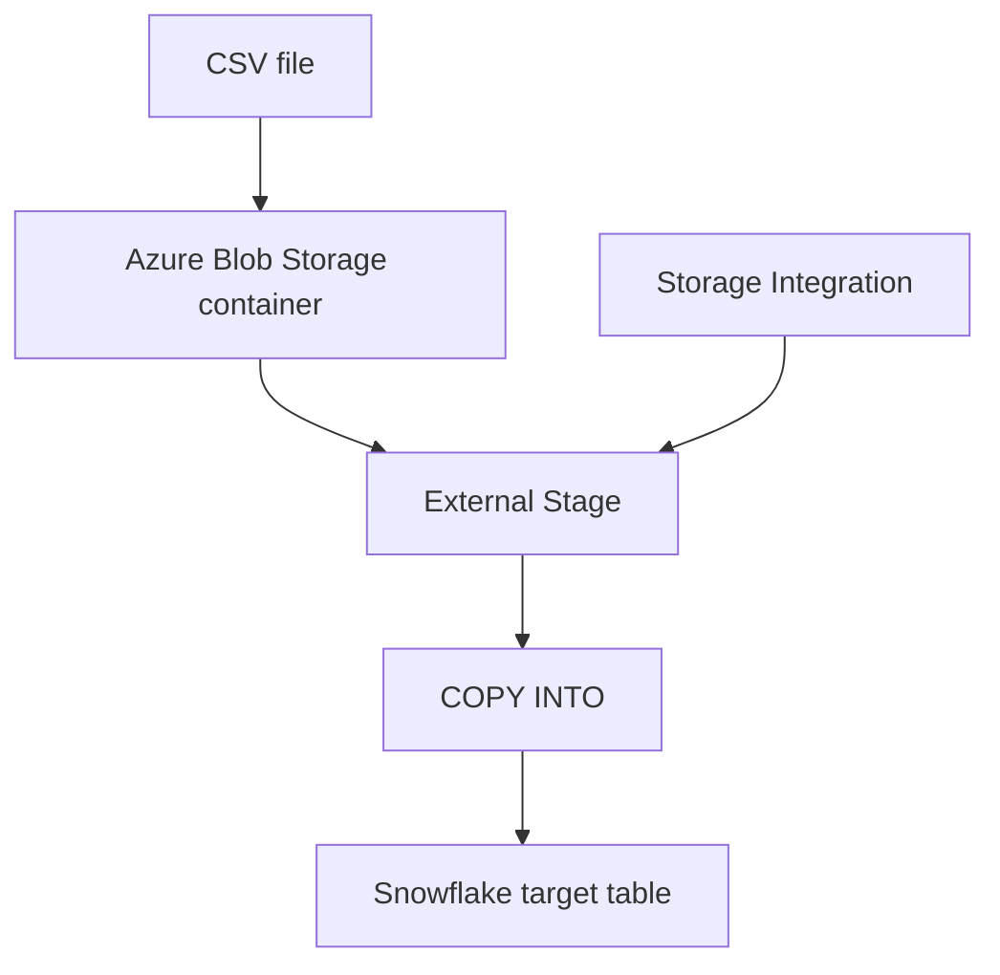

# Azure Blob Storage and Snowflake Storage Integration

## 1. Goal

Understand how files in Azure Blob Storage can be accessed by Snowflake through a Storage Integration and an external stage. This is the foundation for loading files with `COPY INTO` or Snowpipe.

## 2. Core concepts

| Term | Meaning |
|---|---|
| Storage Account | Azure resource that provides storage services |
| Blob Storage | Azure object storage for files |
| Container | Logical grouping of blobs |
| Blob | An individual stored object/file |
| Storage Integration | Snowflake object configuring secure access to external cloud storage |
| External Stage | Snowflake object pointing to an external file location |

Example:

```text
Azure Storage Account: myblobaccount
  Container: incoming
    employees.csv
    customers.csv
```

Blob Storage stores the actual files. A Snowflake stage references their external location; it does not copy them into Snowflake.

## 3. Why Storage Integration?

Storage Integration provides a managed authorization configuration for Snowflake to access Azure storage. It avoids embedding long-lived cloud credentials directly in each stage definition.

The Azure administrator authorizes the Snowflake application and grants the required Blob data permissions. For read-only ingestion, `Storage Blob Data Reader` is commonly suitable when scoped appropriately. Confirm the current least-privilege requirement for your environment.

## 4. Create a Storage Integration

Use your actual Azure tenant ID and allowed storage URL. These values are examples:

```sql
CREATE STORAGE INTEGRATION MY_AZURE_STORAGE_INT
    TYPE = EXTERNAL_STAGE
    STORAGE_PROVIDER = AZURE
    ENABLED = TRUE
    AZURE_TENANT_ID = '<AZURE_TENANT_ID>'
    STORAGE_ALLOWED_LOCATIONS = (
      'azure://myblobaccount.blob.core.windows.net/incoming/'
    );
```

Inspect it:

```sql
DESC INTEGRATION MY_AZURE_STORAGE_INT;
```

Use the returned consent URL and application information in the Azure authorization process described in Snowflake's current Azure integration documentation. An authorized Azure administrator completes consent and assigns the appropriate Blob data role.

## 5. Create a file format

For a CSV file with a header row:

```sql
CREATE FILE FORMAT COMPANY_DB.PUBLIC.EMPLOYEE_CSV_FORMAT
    TYPE = CSV
    SKIP_HEADER = 1
    FIELD_OPTIONALLY_ENCLOSED_BY = '"';
```

A file format tells Snowflake how to interpret the file structure.

## 6. Create an external stage

```sql
CREATE STAGE COMPANY_DB.PUBLIC.EMPLOYEE_STAGE
    URL = 'azure://myblobaccount.blob.core.windows.net/incoming/'
    STORAGE_INTEGRATION = MY_AZURE_STORAGE_INT
    FILE_FORMAT = COMPANY_DB.PUBLIC.EMPLOYEE_CSV_FORMAT;
```

The stage points to the container/path and references the Storage Integration.

## 7. Inspect files

```sql
LIST @COMPANY_DB.PUBLIC.EMPLOYEE_STAGE;
```

This lists files Snowflake can see through the stage. If expected files are missing, check URL, path, allowed locations, Azure permissions and file placement.

## 8. Load data manually with COPY INTO

Create a target table:

```sql
CREATE TABLE COMPANY_DB.PUBLIC.EMPLOYEES (
    ID NUMBER,
    NAME STRING,
    DEPARTMENT STRING,
    SALARY NUMBER
);
```

Load the staged file:

```sql
COPY INTO COMPANY_DB.PUBLIC.EMPLOYEES
FROM @COMPANY_DB.PUBLIC.EMPLOYEE_STAGE
FILE_FORMAT = (FORMAT_NAME = 'COMPANY_DB.PUBLIC.EMPLOYEE_CSV_FORMAT');
```

`COPY INTO` loads staged files into a Snowflake table. It can be run manually or stored inside a Snowflake Pipe.

## 9. Architecture



## 10. Troubleshooting

| Symptom | What to check |
|---|---|
| Authorization error | Azure application consent and Blob data role |
| File not found | Storage account, container, path and stage URL |
| Location not allowed | `STORAGE_ALLOWED_LOCATIONS` |
| CSV parsing error | File format options, delimiter, header and quoting |
| No files listed | Confirm upload completed and inspect the correct stage path |

## 11. Key distinctions

- Storage Account: Azure resource.
- Container: grouping of blobs.
- Blob: actual file/object.
- Storage Integration: authorization/configuration for Snowflake's external storage access.
- External Stage: named reference to the external file location.
- `COPY INTO`: loads staged data into a Snowflake table.

For Snowpipe on Azure, a separate Notification Integration connects Snowflake to Azure Queue Storage. It does not replace the Storage Integration.
