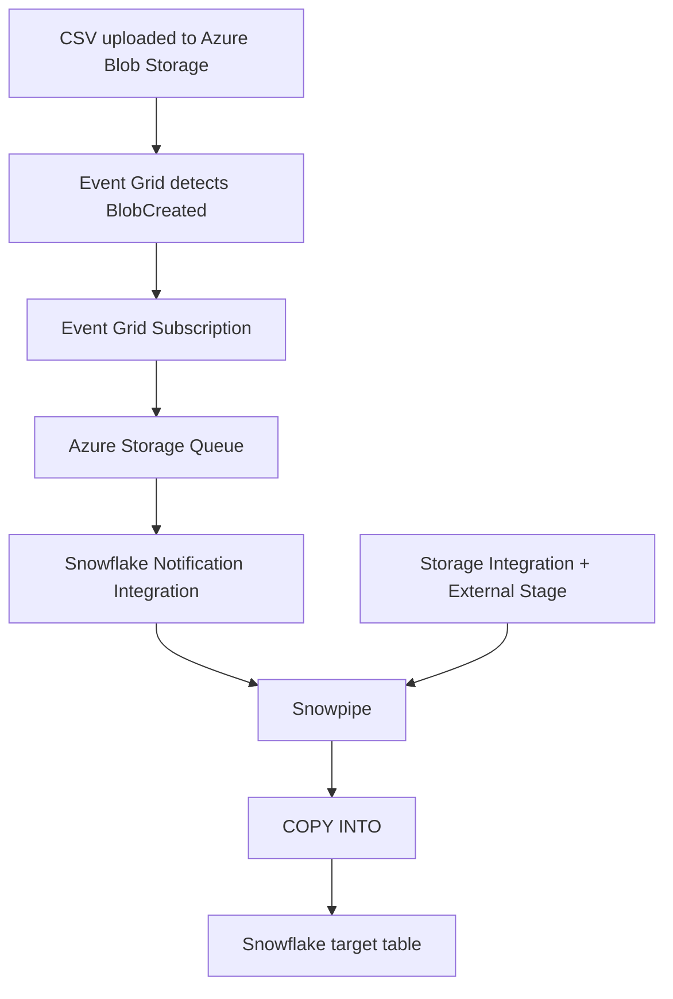
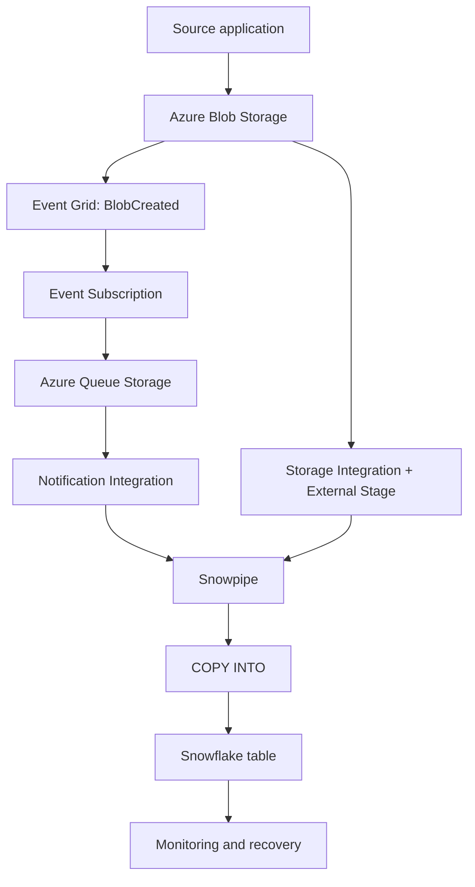

# Snowpipe with Azure Blob Storage — End-to-End Implementation

## 1. Goal and architecture

Automatically load files arriving in Azure Blob Storage into Snowflake without manually running `COPY INTO` for every file.



Two separate connections are essential:

- **Storage Integration:** allows Snowflake to read files from Azure Blob Storage.
- **Notification Integration:** allows Snowflake to receive file-arrival notifications from Azure Queue Storage.

A notification tells Snowpipe *which file arrived*. Storage Integration allows Snowflake to *read that file*.

## 2. Example environment

All names and IDs below are examples. Replace them with your actual values.

| Object | Example |
|---|---|
| Azure Storage Account | `myblobaccount` |
| Blob container | `incoming` |
| Azure Queue | `snowpipe-queue` |
| Database/schema | `COMPANY_DB.PUBLIC` |
| Target table | `EMPLOYEES` |
| External stage | `EMPLOYEE_STAGE` |
| Storage Integration | `MY_AZURE_STORAGE_INT` |
| Notification Integration | `MY_AZURE_NOTIFICATION_INT` |
| Pipe | `EMPLOYEE_PIPE` |

Example source file:

```csv
ID,NAME,DEPARTMENT,SALARY
101,Ravi,IT,45000
102,Anu,HR,40000
103,John,Finance,50000
```

Create a target table:

```sql
CREATE OR REPLACE TABLE COMPANY_DB.PUBLIC.EMPLOYEES (
    ID NUMBER,
    NAME STRING,
    DEPARTMENT STRING,
    SALARY NUMBER
);
```

## 3. Azure Blob Storage

Blob Storage stores the actual files. A container groups blobs.

```text
Storage account: myblobaccount
  Container: incoming
    employees_2026_11_02.csv
    customers_2026_11_02.csv
```

The CSV contents are in Blob Storage, not in the event queue.

## 4. Storage Integration

A Storage Integration configures Snowflake's secure access to Azure storage. It avoids embedding long-lived cloud credentials in each stage.

Create an integration using your Azure tenant ID and allowed storage location:

```sql
CREATE STORAGE INTEGRATION MY_AZURE_STORAGE_INT
    TYPE = EXTERNAL_STAGE
    STORAGE_PROVIDER = AZURE
    ENABLED = TRUE
    AZURE_TENANT_ID = '<AZURE_TENANT_ID>'
    STORAGE_ALLOWED_LOCATIONS = (
      'azure://myblobaccount.blob.core.windows.net/incoming/'
    );
```

Inspect it:

```sql
DESC INTEGRATION MY_AZURE_STORAGE_INT;
```

Use the returned consent URL and application identity in Azure. An authorized Azure administrator grants the Snowflake application the required Blob data permission. For read-only ingestion, `Storage Blob Data Reader` is commonly appropriate; confirm the current least-privilege requirement for your setup.

Create a CSV file format:

```sql
CREATE OR REPLACE FILE FORMAT COMPANY_DB.PUBLIC.EMPLOYEE_CSV_FORMAT
    TYPE = CSV
    SKIP_HEADER = 1
    FIELD_OPTIONALLY_ENCLOSED_BY = '"';
```

Create an external stage:

```sql
CREATE OR REPLACE STAGE COMPANY_DB.PUBLIC.EMPLOYEE_STAGE
    URL = 'azure://myblobaccount.blob.core.windows.net/incoming/'
    STORAGE_INTEGRATION = MY_AZURE_STORAGE_INT
    FILE_FORMAT = COMPANY_DB.PUBLIC.EMPLOYEE_CSV_FORMAT;
```

List files:

```sql
LIST @COMPANY_DB.PUBLIC.EMPLOYEE_STAGE;
```

## 5. Azure Queue Storage

Azure Queue Storage stores notification messages; it does not store the CSV file.

Create a queue inside an Azure Storage Account, for example `snowpipe-queue`. Event messages carry information about the storage event and blob location. The exact message body is generated by the event provider.

The queue provides a buffer between event delivery and consumption.

## 6. Azure Event Grid

Event Grid detects events from Azure resources and routes them to configured handlers.

For this implementation:

- Source: Azure Blob Storage.
- Event type: `Microsoft.Storage.BlobCreated`.
- Destination: Azure Storage Queue.
- Routing configuration: Event Grid Subscription.

In Azure Portal, create an Event Subscription for the storage account, select the Blob Created event, choose Storage Queue as the endpoint, and select the queue created for Snowpipe.

Subject filters can limit which container or path triggers the pipeline. Ensure filters match the actual upload path.

```text
Blob created
  -> Event Grid detects event
  -> Event Subscription routes event
  -> Queue receives notification
```

## 7. Snowflake Notification Integration

Notification Integration configures Snowflake's access to Azure Queue Storage. It is separate from Storage Integration.

Example queue URL:

```text
https://myqueueaccount.queue.core.windows.net/snowpipe-queue
```

Create the integration:

```sql
CREATE NOTIFICATION INTEGRATION MY_AZURE_NOTIFICATION_INT
    ENABLED = TRUE
    TYPE = QUEUE
    NOTIFICATION_PROVIDER = AZURE_STORAGE_QUEUE
    AZURE_STORAGE_QUEUE_PRIMARY_URI =
      'https://myqueueaccount.queue.core.windows.net/snowpipe-queue'
    AZURE_TENANT_ID = '<AZURE_TENANT_ID>';
```

Inspect it:

```sql
DESC NOTIFICATION INTEGRATION MY_AZURE_NOTIFICATION_INT;
```

Use the returned `AZURE_CONSENT_URL` to authorize the Snowflake application in Microsoft Entra ID. The returned `AZURE_MULTI_TENANT_APP_NAME` identifies the application/service principal to which the Azure queue role must be assigned.

Grant the Snowflake application the required queue data permissions. `Storage Queue Data Contributor` is commonly used in this setup; confirm the least-privilege role required by the current Snowflake instructions.

Grant a Snowflake role permission to use the integration:

```sql
GRANT USAGE ON INTEGRATION MY_AZURE_NOTIFICATION_INT
    TO ROLE SYSADMIN;
```

`SYSADMIN` is only an example. Prefer a dedicated role with the necessary privileges in production.

## 8. Create the Snowpipe

A Pipe stores a `COPY INTO` command. With automatic ingestion enabled, notifications can trigger Snowpipe to load newly arrived files.

```sql
CREATE PIPE COMPANY_DB.PUBLIC.EMPLOYEE_PIPE
    AUTO_INGEST = TRUE
    INTEGRATION = 'MY_AZURE_NOTIFICATION_INT'
AS
COPY INTO COMPANY_DB.PUBLIC.EMPLOYEES
FROM @COMPANY_DB.PUBLIC.EMPLOYEE_STAGE
FILE_FORMAT = (
    TYPE = CSV
    SKIP_HEADER = 1
    FIELD_OPTIONALLY_ENCLOSED_BY = '"'
);
```

The Pipe owner needs the appropriate privileges on the database, schema, stage, target table, and integration.

Remember:
- `AUTO_INGEST = TRUE` enables event-driven automatic ingestion; it does not configure Event Grid by itself.
- `COPY INTO` defines how the files are loaded.
- The external stage identifies the source location.
- Notification Integration connects Snowflake to the queue.

## 9. Automatic ingestion sequence

1. An application uploads a CSV to Blob Storage.
2. Event Grid detects `BlobCreated`.
3. The Event Subscription routes the event to Queue Storage.
4. Snowflake reads the notification through Notification Integration.
5. Snowpipe identifies the file.
6. The Pipe's `COPY INTO` command reads the file through the external stage.
7. Rows are loaded into the target table.

Snowpipe uses Snowflake-managed serverless compute. It does not require the customer to assign a virtual warehouse for Snowpipe ingestion. Ordinary queries against the resulting table use a warehouse.

## 10. Monitoring

Check Pipe status:

```sql
SELECT SYSTEM$PIPE_STATUS(
    'COMPANY_DB.PUBLIC.EMPLOYEE_PIPE'
);
```

The returned JSON contains diagnostic information such as execution state, pending file count, timestamps and error details. Interpret the fields actually returned.

Check recent load history:

```sql
SELECT
    FILE_NAME,
    STATUS,
    ROW_COUNT,
    FIRST_ERROR_MESSAGE,
    LAST_LOAD_TIME
FROM TABLE(
    COMPANY_DB.INFORMATION_SCHEMA.COPY_HISTORY(
        TABLE_NAME => 'EMPLOYEES',
        START_TIME => DATEADD('HOUR', -24, CURRENT_TIMESTAMP())
    )
)
ORDER BY LAST_LOAD_TIME DESC;
```

Inspect files visible through the stage:

```sql
LIST @COMPANY_DB.PUBLIC.EMPLOYEE_STAGE;
```

Information Schema history functions have limited history windows. Use Account Usage history views for longer-term analysis, allowing for their reporting latency.

## 11. Troubleshooting

### File exists in Blob but is not in Snowflake

1. Confirm the blob exists at the expected path.
2. Check Event Grid Subscription, event type, endpoint and filters.
3. Confirm the event reaches the expected queue.
4. Check Notification Integration and Azure queue permissions.
5. Check `SYSTEM$PIPE_STATUS`.
6. Check COPY history and Snowpipe events.
7. Confirm the Pipe references the correct stage and table.

### Snowflake cannot read the blob

Check Storage Integration, allowed locations, Azure Blob role assignment, stage URL, path and whether the file still exists.

### Invalid CSV data

Inspect COPY history and use Snowpipe validation where appropriate:

```sql
SELECT *
FROM TABLE(
    COMPANY_DB.INFORMATION_SCHEMA.VALIDATE_PIPE_LOAD(
        PIPE_NAME => 'COMPANY_DB.PUBLIC.EMPLOYEE_PIPE',
        START_TIME => DATEADD('HOUR', -24, CURRENT_TIMESTAMP())
    )
);
```

Check current Snowflake documentation for supported arguments and output.

### Pipe paused

```sql
ALTER PIPE COMPANY_DB.PUBLIC.EMPLOYEE_PIPE
    SET PIPE_EXECUTION_PAUSED = TRUE;

ALTER PIPE COMPANY_DB.PUBLIC.EMPLOYEE_PIPE
    SET PIPE_EXECUTION_PAUSED = FALSE;
```

Understand queue retention and resume behavior before leaving a Pipe paused for an extended period.

### Existing files were present before Pipe creation

```sql
ALTER PIPE COMPANY_DB.PUBLIC.EMPLOYEE_PIPE REFRESH;
```

Refresh requests discovery of eligible existing files. It has limits and eligibility rules; it is not a universal retry mechanism for every previously attempted failed file.

### Duplicate business records

Snowpipe tracks file ingestion metadata, but this does not guarantee business-level uniqueness. Different files may contain the same business key. Use SQL deduplication or `MERGE` logic where needed.

## 12. Events and alerts

Snowflake event tables can record telemetry such as notification receipt, file lifecycle, pipe lifecycle and notification channel errors.

Example:

```sql
ALTER PIPE COMPANY_DB.PUBLIC.EMPLOYEE_PIPE
    SET LOG_EVENT_LEVEL = INFO;
```

An event table and suitable telemetry configuration must also be in place. Event collection can have cost implications.

For operational monitoring, consider:
- Snowpipe load-error notifications.
- Event-table monitoring and Snowflake alerts.
- Azure Monitor for Azure-side health.
- A freshness check that alerts when expected files or successful ingestions stop arriving.

A silent interruption in event delivery may not produce the same error as a failed COPY operation.

## 13. Interview revision

| Question | Main answer |
|---|---|
| What is Snowpipe? | Snowflake-managed continuous file ingestion. |
| What is a Pipe? | A Snowflake object storing a `COPY INTO` statement. |
| What does AUTO_INGEST do? | Enables event-driven automatic ingestion with cloud notifications. |
| What does Event Grid do? | Detects and routes Azure events. |
| What does Queue Storage contain? | Notification messages, not CSV data. |
| Why two integrations? | Storage Integration grants Blob access; Notification Integration connects to the queue. |
| Does Snowpipe need a customer-managed warehouse? | No, it uses serverless compute. |
| How do you check status? | `SYSTEM$PIPE_STATUS`. |
| How do you inspect loaded files? | `COPY_HISTORY`. |
| How do you inspect stage files? | `LIST @stage`. |
| How do you discover eligible existing files? | `ALTER PIPE ... REFRESH`. |
| Does file tracking eliminate all duplicates? | No; business-level duplicates need data-quality logic. |

## 14. Summary



**Remember:** The queue tells Snowflake which file arrived. The stage and Storage Integration let Snowflake read the file. The Pipe contains the loading instructions.
